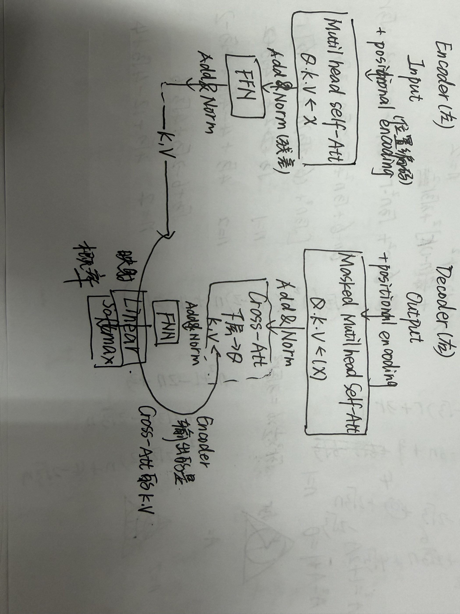

# 图1与Transformer简化结构图
结构:左侧(Encoder):六个相同的层堆叠,每层包含两个子层:Multi-Head Self-Attention和FFN,每个子层后都有残差连接和Layer Normalization
右侧(Decoder):六个相同的层堆叠,每层包含三个字层:Masked Multi-Head Self-Attention,Cross-Attention(接收Encoder输出),同样每层后面都有Add,Norm

# 阅读
Scaled Dot-Product Attention(缩放点积注意力)
公式 Q,K做矩阵点积-除以更号下dk做缩放--softmax得到权重--和v相乘
缩放:维度很大时,点积结果会非常大,导致softmax函数进入梯度消失,除以过后稳定训练
Multi-Head Attention(多头注意力)
将Q,K,V通过不同的线性变换映射到多个子空间,分别计算注意力,最后拼接并线性变换得到最终输出
优势:让模型可以同时在多个子空间学习不同类型的依赖关系
Position-wise Feed-Forward Network (FFN)
两层线性变换,中间夹着ReLU激活函数--等价两个1*1卷积
**笔记和疑问见note**
# 最初处理的是什么任务？它为什么尝试不用 RNN 和 CNN？
初始任务:机器翻译(WMT 2014 英德.英法任务)
为什么不用:RNN必须顺序计算,无法并行,长距离以来差;CNN感受野扩大满,需要堆叠多层;Transformer仅靠注意力就能实现全局依赖捕捉,且高度并行化
# Self-Attention 的"Self"
指Query,Key,Value三者来自同一个输入序列,在序列内部寻找词与词之间的关联
与普通attention区别:普通的Q来自Decoder,K,V来自Encoder;Self-Attention是自己看自己
# Q,K,V的来源与线性变换
来源:均由输入向量X乘以三个不同的可学习权重矩阵(线性变换)得到--三个输入表示向量
用不同变换:给同一个词赋予了三种不同的身份,为了让模型在不同的表示子空间里提取特征,如果Q,K,V相同,模型只能计算简单的自身相似度,无法学习复杂的语义映射;(Multi-Head Attention)成立基础
# Softmax 的作用与权重含义
作用:将点积得到的原始分数转化为概率分布,保证权重全为正且和为1方,便后续加权求和
每行权重含义:当前词(Query)对序列中所有词(Keys)的关注程度,数值越大,相关性越高
# Multi-Head的作用
分头:不同的头将输入映射到不同的子空,可以同时关注不同的特征
是重复吗:不是,每个头有独立的参数,学到的是不同的特征表示,最后拼接起来综合了多视角信息
# 词语先后顺序
通过Positional Encoding(位置编码)因为Self-Attention本身是位置无关的(打乱词序结果不变),必须把包含位置信息的向量加上
# Decoder 中的 Masked Attention
需要原因:训练时Decoder是并行处理的(看全句),但推理时只能看前面的词,为了防止训练时模型提前看到后面的词,要将未来位置Mask掉
提前看到:模型会复制后面的词,无法学到真正的语言生成规律,训练失效
# 三大组件的位置与作用
残差连接(Add):在结构图中绕过每个子层(Attention/FFN)的箭头
    作用:缓解深层网络梯度消失,让信息更容易流动
Layer Normalization(Norm):跟在残差连接之后
    作用:稳定训练,加速收敛
FFN:跟在Attention子层之后
    作用:通过非线性变换(两层线性+ReLU),增强模型的拟合能力